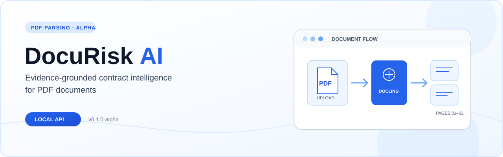

  <strong>Evidence-grounded contract intelligence for PDF documents</strong> 
  A local, English-first parsing foundation for future contract analysis.

  <a href="#quick-start">Quick start</a> ·
  <a href="#architecture">Architecture</a> ·
  <a href="#testing-status">Testing status</a> ·
  <a href="#roadmap">Roadmap</a>

  
  
  

> **Alpha status:** DocuRisk AI currently parses English, text-based PDFs and returns per-page content through an API. It does **not** classify contract risks, offer legal advice, generate evidence citations, or support production or multi-user deployment. v0.1.0-alpha is a source version, not a GitHub Release.

## Overview

DocuRisk AI is the first layer of a planned evidence-grounded contract intelligence system. Today it accepts a PDF, validates basic constraints, extracts page-level text and Markdown with Docling, and keeps document status and results in local SQLite storage. The API is designed for single-user evaluation on a local machine.

**Current envelope:** born-digital English PDFs · up to 20 MiB · 1–100 pages · localhost Docker Compose deployment.

## Features

| Capability | What the alpha provides |
| --- | --- |
| PDF intake | Authenticated upload with extension, media-type, signature, size, page-count, and text-presence checks. Image-only, encrypted, and malformed PDFs are rejected. |
| Page extraction | Docling conversion with OCR disabled; per-page plain text and Markdown are stored alongside document metadata and SHA-256. |
| Job lifecycle | HTTP 202 response followed by queued, running, completed, or failed status; clients can fetch pages and delete completed or failed documents. |
| Local persistence | SQLite metadata and extracted pages plus PDFs in a private Docker named volume. |
| Operational boundaries | A time-bounded parser child process and constrained container settings for local development. These are not a complete security sandbox. |

## Architecture

~~~mermaid
flowchart LR
    C["Local client"] -->|"PDF + X-API-Key"| A["FastAPI HTTP 202 + status API"]
    A -->|"metadata / pages"| S[("SQLite")]
    A -->|"save upload"| V[("Local Docker volume")]
    A -->|"BackgroundTasks"| B["Job coordinator"]
    B -->|"bounded child process"| P["pypdf inspection + Docling conversion"]
    P -->|"page text + Markdown"| S
    P -->|"source PDF"| V
~~~

The upload responds before parsing finishes. FastAPI BackgroundTasks coordinates the child process; it is **not a durable job queue**. A server restart can leave a job pending. See [security and execution notes](docs/SECURITY_REVIEW.md).

## Testing status

The [November 10, 2026 main-branch CI run](https://github.com/erfansasani/docurisk-ai/actions/runs/42858048130) passed all three jobs below. This is verified baseline evidence for the code documented here; review this PR's own checks separately.

| CI job | Verified scope |
| --- | --- |
| [Unit tests](https://github.com/erfansasani/docurisk-ai/actions/runs/42858048130/job/129976348136) | Fast API and parser checks with a stubbed conversion path. |
| [Real Docling PDF](https://github.com/erfansasani/docurisk-ai/actions/runs/42858048130/job/129976347597) | A dedicated integration test performs real PDF conversion. |
| [Docker HTTP E2E](https://github.com/erfansasani/docurisk-ai/actions/runs/42858048130/job/129976347941) | Builds the image, runs the API in Docker Compose, and passes four HTTP scenarios using a synthetic PDF: two-page upload/extraction/deletion, authentication and validation, malformed-PDF failure, and the 20 MiB limit. |

The E2E check uses generated data. It is not a performance benchmark, a security audit, or proof that arbitrary contracts parse correctly. See the [E2E guide](docs/E2E_TESTING.md) for local reproduction and cleanup.

For the fast suite without Docling model assets:

~~~bash
python -m pip install -e '.[test]'
python -m pytest -q
~~~

## Security

The alpha requires one X-API-Key, binds Docker Compose to **127.0.0.1:8000**, checks upload limits, and returns safe parser error codes without exposing raw exception text. The container runs as a non-root user with a read-only root filesystem, dropped capabilities, and resource limits.

**Use only test or non-confidential PDFs.** The parser child process still shares container networking and volumes. There is no multi-user authorization, rate limiting, encrypted storage, retention policy, durable queue, or independent security audit. Do not expose this service publicly. Details and residual risks are recorded in the [security review](docs/SECURITY_REVIEW.md).

## Quick start

Requires Docker Compose. Docling may download model assets on first use, and its image is comparatively large.

~~~bash
cp .env.example .env
# Replace DOCURISK_API_KEY in .env with a long random secret.
# Generate one with: python -c "import secrets; print(secrets.token_urlsafe(48))"
docker compose up --build
~~~

Open the local [OpenAPI documentation](http://127.0.0.1:8000/docs). In another terminal:

~~~bash
curl -X POST http://127.0.0.1:8000/api/v1/documents \
  -H 'X-API-Key: YOUR_SECRET' \
  -F 'file=@agreement.pdf;type=application/pdf'
# {"document_id":"...","status":"queued","page_count":null}

curl -H 'X-API-Key: YOUR_SECRET' \
  http://127.0.0.1:8000/api/v1/documents/DOCUMENT_ID

curl -H 'X-API-Key: YOUR_SECRET' \
  http://127.0.0.1:8000/api/v1/documents/DOCUMENT_ID/pages/1
~~~

Poll document status until it is completed before requesting pages. Keep your .env file and uploaded PDFs out of Git.

## Roadmap

- **Now — PDF foundation:** local authenticated upload, real Docling extraction, page storage, and CI-backed HTTP E2E coverage.
- **Next — reliable processing and provenance:** durable jobs, structured page/section data, and source references.
- **Later — contract intelligence:** evidence-grounded retrieval, clause analysis, measured evaluation on held-out datasets such as CUAD, and Persian/RTL support.

Track planned work in [GitHub Issues](https://github.com/erfansasani/docurisk-ai/issues). OCR, RAG, risk scoring, citations/bounding boxes, and a web frontend are **not implemented**.

---

Project-local development and review conventions: [AGENTS.md](AGENTS.md) · [ECC setup](docs/ECC_SETUP.md)
